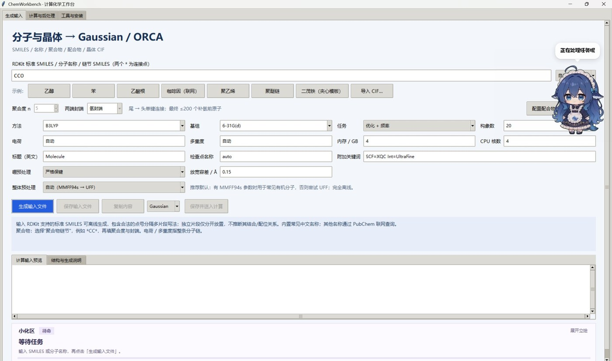

# Little-Chem-Bug

程序名 ChemWorkbench，中文名「化小区」。面向 Gaussian 和 ORCA 的 Windows 桌面工具：从 SMILES、分子名称、聚合物链节、金属配合物或 CIF 晶体结构生成三维起始几何和可直接提交的输入文件；批量跑完计算后，在同一个界面里完成日志解析、前线轨道、静电势表面和能量分析。

**A Windows GUI for Gaussian and ORCA: build 3D inputs from SMILES, names, polymers, metal complexes or CIF files, batch-run jobs, then analyze results — log reports, HOMO/LUMO levels, ESP surfaces (Multiwfn + VMD), binding and solvation energies, and density differences. Self-contained x64 build, no Python needed; input generation works offline.**



## 下载（Windows x64）

不用安装 Python。到 [Releases](https://github.com/paider-nk/Little-Chem-Bug/releases/latest) 下载 `ChemWorkbench-<版本>-Windows-x64.zip`，**完整解压**后双击 `ChemWorkbench.exe`；同级的 `_internal` 目录必须保留，不要只把 exe 单独拷出来。

生成输入文件可以完全离线。真正的计算与后处理需要在「工具与安装」页连接 Gaussian 16 或 ORCA，以及按需连接 Multiwfn、VMD、xTB、molSimplify——这些外部程序不随本程序分发。

详细操作步骤见 [使用说明.md](使用说明.md)。

## 从源码启动工作台（Windows x64）

把本仓库克隆或下载到可写目录。安装带 Tcl/Tk 的 64 位 Python 3.13。在含 `requirements.txt` 的目录打开 PowerShell，运行：

```powershell
python -m venv .venv
.\.venv\Scripts\python.exe -m pip install -r requirements.txt
.\workbench.bat
```

如果系统同时装了多个 Python，可用 `py -3.13 -m venv .venv` 创建环境。依赖安装完成后，可以双击 `workbench.bat` 启动。Python 入口为 `chem_workbench.py`，同一窗口包含“生成输入”“计算与后处理”和“工具与安装”。各功能的操作步骤见 [使用说明.md](使用说明.md)。

- `requirements.txt` 是工作台的 Python 依赖。
- `requirements-molsimplify.txt` 用于可选的 molSimplify 配合物后端。请在“工具与安装”中安装或选择已有的后端 Python。自动安装使用独立的 Python 3.12 环境。
- `requirements-build.txt` 用于打包 Windows 运行版。在 Windows x64 的同一个 `.venv` 中安装它，再执行 `.\.venv\Scripts\python.exe build_release.py`。

首次安装依赖需要联网。输入 SMILES 或内置名称可离线生成结构。其他名称会发送给 PubChem 查询。Gaussian、ORCA、Multiwfn、VMD 和 xTB 的路径可在“工具与安装”中配置。

### 看板娘「小化区」

输入生成器（`start.bat`）和计算工作流（`workflow.bat`）底部都有看板。小化区会轻轻浮动和眨眼。苯环、电化学池、色谱峰、轨道示意图、八面体配合物和反应能量曲线沿椭圆轨道绕行，对应有机化学、电化学、分析化学、计算化学、无机化学和物理化学。

- 输入生成和后处理会显示当前步骤，进度条随处理状态活动。
- Gaussian 批量运行显示已结束／总数，并分别统计正常和异常。单个任务运行时会在退出后更新计数。
- 点击「暂停动画」可以暂停立绘和图标的动画，也可以点击「收起立绘」。两种操作下状态和进度提示都继续更新。

## 输入示例

| 输入 | 含义 | 预期电荷 / 多重度 |
| --- | --- | --- |
| `CCO` 或 `乙醇` | 乙醇 | 0 / 1 |
| `c1ccccc1` 或 `苯` | 苯 | 0 / 1 |
| `CC(=O)[O-]` 或 `乙酸根` | 乙酸根离子 | -1 / 1 |
| `[NH4+]` 或 `铵根` | 铵根离子 | +1 / 1 |
| `[CH3]` | 甲基自由基 | 0 / 2 |
| `[O][O]` | 以两个自由基电子表示的氧气 | 0 / 3（仍需确认目标态） |
| `N[C@@H](C)C(=O)O` | 指定手性的丙氨酸 | 0 / 1 |
| `caffeine` | 咖啡因，PubChem 联网查询 | 0 / 1 |

内置水、乙醇、甲醇、苯、甲苯、丙酮、乙酸、乙腈、二氯甲烷、四氢呋喃、二甲基亚砜等常见名称。其他名称建议使用英文或 IUPAC 名称；不能保证 PubChem 支持任意中文名称。自动模式先尝试 SMILES，再尝试名称；如名字恰好可解析为 SMILES，请显式选择“分子名称”。

## 聚合物链节与聚合度

1. 选择输入类型“**聚合物链节**”，或点击“聚乙烯 / 聚醚链”示例。
2. 输入链节 SMILES，用**恰好两个 `*`** 标记连接位置。
3. 填写聚合度 `n`，选择两端“氢封端”或“甲基封端”，再生成和保存。聚合度表示链节重复次数，封端基团不计入聚合度。

| 链节 SMILES | n | 封端 | 生成的有限链 |
| --- | --- | --- | --- |
| `*CC*` | 5 | 氢 | 聚乙烯链节重复 5 次，`C10H22` |
| `*CC*` | 5 | 甲基 | 在相同链节两端加甲基，`C12H26` |
| `[*:1]CCO[*:2]` | 3 | 氢 | 聚醚链，`CCOCCOCCO`，`C6H14O3` |
| `*CC(C)*` | 4 | 氢 | 含甲基支链的重复结构，`C12H26`；未指定的手性会提示 |

输入的是**完成成键后的重复链节**。例如聚乙烯应输入 `*CC*`；直接输入单体 `C=C` 不会自动发生聚合反应。链节内原有键保持不变，各链节之间通过单键连接。每个 `*` 必须只通过一条单键连接真实非氢原子。

可用 `[*:1]` 表示头、`[*:2]` 表示尾；连接方向为“当前链节尾 → 下一链节头”。若均使用未编号的 `*`，按输入 SMILES 中两个连接点的解析顺序确定头尾。不能混用编号和未编号连接点。输出说明会列出完整分子链 SMILES，便于检查。

聚合度可设为 **1–100 的整数**，同时最终结构最多 **200 个补氢前原子**，因此较大链节的可用聚合度会更低。例如 `*CC*` 氢封端最多 n=100，甲基封端最多 n=99。长链三维嵌入和构象搜索可能很慢；可先用 1–5 个构象试算，正式研究需充分采样。

本功能生成**有限长度、两端封端的单条分子链**，适用于 Gaussian 分子计算；不构建周期性无限链、多链堆积、交联网络或共聚序列。输入中已指定的立体信息会逐链节复制，不自动枚举无规 / 间规结构。电荷和多重度设置作用于**整条链**；默认电荷会累计各链节的形式电荷。聚合物模式完全离线。

## 计算参数

- 默认：`#p B3LYP/6-31G(d) Opt Freq SCF=XQC Int=UltraFine`，4 GB 内存、4 核。
- 可选优化+频率、几何优化、单点能、频率；方法和基组可选择或手动输入 Gaussian 内置名称。
- 自动电荷来自 SMILES 形式电荷。手动覆盖电荷只改变电子数，不改变质子化状态或氢数；需要质子化 / 去质子化时应修改结构，例如 `N` 与 `[NH4+]`。
- 自动多重度由显式自由基电子与电子数推断；多个自由基默认采用高自旋。电子数奇偶一致仅是必要条件，不能确定基态。金属、开壳层或激发态请手动指定；过渡金属 / f 区元素禁止自动多重度。
- 附加关键词可填 `EmpiricalDispersion=GD3BJ`、`SCF=(XQC,MaxCycle=512)` 等简单选项。需要额外输入段或读取已有检查点的任务（如 Gen/GenECP、Geom=AllCheck、Guess=Read、ModRedundant、QST2）不支持。当前界面也不提供 SCRF 溶剂设置。
- 标题和手动检查点名称使用英文。检查点名称默认为 `auto`，由分子输入生成名称；聚合物还包含聚合度和封端信息。同一分子的不同任务请手动使用不同名称，避免检查点覆盖。输出正文为 ASCII、LF 换行，坐标单位 Å，保留 Gaussian 所需的空行；带同位素标记时使用如 `C(Iso=13)`。

## 三维结构的来源与适用范围

使用 RDKit ETKDGv3（固定随机种子），最多生成指定数量的构象，再按“整体预处理”选项优化。默认“自动（MMFF94s → UFF）”保持原行为：常见有机分子优先 MMFF94s，没有参数时尝试 UFF。也可以选择 UFF、xTB GFN2-xTB、GFN2-xTB / tblite、xTB GFN-FF 或仅 ETKDG。界面报告的 kcal/mol 是力场能量，不是量子化学能量；xTB 当前作为起始坐标优化器，不把 xTB 能量写成 Gaussian 能量。

各方法的使用场景：

| 方法 | 依赖 | 推荐场景 | 主要限制 |
| --- | --- | --- | --- |
| 自动（MMFF94s → UFF） | RDKit 内置 | 默认选择，常见有机小分子 | 不能保证金属、特殊价态或大体系有可靠参数 |
| MMFF94s | RDKit 内置 | 常见有机分子、构象筛选、小分子 | 元素和价态覆盖有限，不能作为金属配合物模型 |
| UFF | RDKit 内置 | 无机结构、较广元素范围、含部分金属的初始坐标 | 通用参数近似，电荷、配位和非键作用描述有限 |
| xTB GFN2-xTB | 外部 `xtb.exe` | 中等/大分子、主族体系、带电结构和非键作用 | 需要单独安装；结果仍是初始几何，不替代 Gaussian 优化 |
| GFN2-xTB / tblite（严格优化） | 内置 tblite 的 `xtb.exe` | 有机、主族及部分金属结构，需更严格收敛的初始几何 | 同一 GFN2-xTB 方法的另一计算后端；`tight` 收紧数值收敛，不提升理论级别 |
| xTB GFN-FF | 外部 `xtb.exe` | 大分子、聚合物、快速金属/有机初猜 | 速度优先，不能用于最终电子结构或精确能量结论 |
| 仅 ETKDG | RDKit 内置 | 快速检查拓扑，或准备交给 Gaussian/其他量化程序优化 | 不做键长、键角和非键接触预优化 |

xTB 模式通过 `XTB_EXE` 环境变量或系统 `PATH` 查找 `xtb.exe`。例如：

```powershell
$env:XTB_EXE = 'C:\xtb\xtb.exe'
start.bat "CCO" --preprocess-method xtb -o ethanol_xtb.gjf
start.bat "CCO" --preprocess-method tblite --processors 4 -o ethanol_tblite.gjf
start.bat "*CC*" --mode polymer --degree 20 --preprocess-method gfnff -o polymer_gfnff.gjf
```

如果未安装 xTB，程序不会自动偷偷换用其他方法；会提示安装或改选内置方法。对于含硼结构，所选方法先用于整体构象预优化；严格/放宽硼模式随后仍使用带保键和二面角约束的专用本地步骤，跳过硼平面化则不会执行该本地步骤。

**tblite 后端**：在“整体预处理”选择“GFN2-xTB / tblite（严格优化）”，实际运行 `xtb input.xyz --gfn 2 --opt tight --tblite --chrg N --uhf M --parallel P`。总电荷沿用输入设置，`M=多重度−1`，`P` 为界面 CPU 核数；同时设置子进程 OpenMP/BLAS 线程环境。已安装的 Windows xTB 6.8.0 包含此后端，无需另装 Python `tblite`。其他电脑需提供支持 `--tblite` 的 xTB，缺少支持时明确报错。程序也会读取 Windows 用户级 `XTB_EXE`，便于安装后仍在运行的父进程找到 xTB。

xTB、tblite、GFN-FF 每次优化一个初始构象，不执行全部构象的量化筛选；必须生成收敛标记 `.xtboptok`、不存在 `NOT_CONVERGED`，且原子顺序和坐标检查通过，才导出结果。二茂铁模板及 molSimplify 配合物选用这三种方法时，会在模板/组装几何上继续优化，同时保留原始 Gaussian Connectivity（配位连接仍写为 0.1）；不会重新用 ETKDG 嵌入配合物。tblite 不会自动修复错误的配位输入或确定金属自旋态。

含硼大环若不希望量化预优化后再经过 UFF 平面化，可搭配“硼预处理 → 跳过平面化预处理”；现有 Gaussian 共面二面角冻结及原始键连表仍会写入优化输入。该选项意味着初始坐标未强制共面，需由 Gaussian 后续受约束优化完成。

`examples/ethanol_tblite.*` 和 `examples/boron_macrocycle_tblite.*` 为本机 tblite 后端实际收敛后生成的示例及参数记录。其中含硼大环为用户给定的 `C102H84B2N2`、190 原子结构，使用 4 核、`tight`、跳过 UFF 平面化；已核查保留 207 条原始键及 Gaussian 二面角约束。它是一个起始构象，不代表完成了 Gaussian 优化或全局构象搜索。

这是**初始结构生成器**。不保证得到全局最低能构象，也不判断最佳泛函、基组、赝势或自旋态。默认方案主要作为普通小有机分子的起点；阴离子、重元素、非共价作用等需针对体系选择弥散函数、基组和方法。SMILES 的质子化态、互变异构体及已指定立体信息来自输入，不会自动枚举。未指定立体中心会提示。名称解析后应检查返回的 SMILES 是否为目标结构。

输入按 RDKit 标准 SMILES 解析，因此兼容 ChemDraw 导出的 RDKit 可识别写法；格式包括芳香性、形式电荷、同位素、立体标记和 `.` 分隔的多个片段。限制为 200 个输入原子（补氢前）。多片段会在初始坐标中分开放置，避免彼此重叠；由于点号不包含片段间距、方向或键合关系，这只适用于想保留为独立片段的情况，不能用于自动拼装金属配合物、盐晶体或溶剂化物。

### 金属配合物 SMILES

可输入 RDKit 能解析的金属配位 SMILES；连通结构可用 `->` 表示配位给电子方向，例如四氨合铜(II)的 `N->[Cu+2](<-N)(<-N)<-N`。点号分隔的金属和配体也会作为 RDKit 标准多片段 SMILES 接受，但仅分别生成片段坐标，不会自动组装配位结构。金属体系必须手动设置总自旋多重度；程序不会推断配位数、氧化态、自旋基态或配位几何。以二茂铁片段为例，合法的环戊二烯基阴离子为 `[cH-]1cccc1`，`c1cccc1` 因芳香价态不成立而无法由 RDKit 解析。若需要二茂铁的夹心结构，应输入包含正确配位键的连通结构，或先在 GaussView / Avogadro 中构建并检查几何。

GUI 提供“二茂铁（夹心模板）”示例，或命令行运行 `python gaussian_input.py ferrocene --mode ferrocene -o ferrocene.gjf`。该模板生成交错式 Cp–Fe–Cp 初始几何，并用 Gaussian `Geom=Connectivity` 将 Fe 连到两个 Cp 环的全部 10 个碳，使其作为同一个配位体系参与优化。模板默认中性单重态；这是起始模型，方法、基组、Fe 参数化、电子态及优化后结构仍须按研究目的核查。

### 含硼结构的平面约束

检测到有三个直接成键原子、且邻接基团提供二面角参考原子的三配位 B 时，对于 `Opt` 或 `Opt Freq`，Gaussian 输入加入 B 相关的冻结二面角：主约束为 `180°`，辅助约束为 `0°` 或 `180°`，共同使 B 及三个直接成键原子共面。不会加入 Gaussian 键角约束。所有原有键（包括环闭合键）写入 `Geom=Connectivity`。连接表记录拓扑，本身不会固定优化中的键长。

界面的“硼预处理”有四种选择，只影响本地初始坐标处理；“整体预处理”单独决定 ETKDG 后使用的优化方法：

| 模式 | 行为 | 适用情况 |
| --- | --- | --- |
| 严格保键（默认） | UFF 初步松弛后，约束全部原有键长并调整二面角；最终键长漂移不得超过 0.03 Å | 普通有机硼、小型 BPin |
| 放宽保键 | 各键允许在 UFF 初步松弛长度附近变化，容差默认 ±0.15 Å，可设 0.01–1.00 Å | 初始共面化与环闭合略有冲突的结构 |
| 几何投影（保键共面） | 使用 SciPy 稀疏最小二乘，从整体预处理坐标出发拟合原键长及共面二面角，并检查近距离非键接触 | 大环、刚性桥连或希望尽量保留 xTB 键长的结构 |
| 跳过平面化预处理 | 保留常规构象生成后的坐标，跳过额外的硼 UFF 平面化；仍写入 Gaussian 二面角目标值与冻结指令 | 大环、刚性桥连等预处理失败的结构 |

严格/放宽模式若不能同时满足所选键长容差和二面角要求，会停止并提示改用跳过模式。容差相对于 **UFF 初步松弛后的键长**，不是统一理想键长；增大容差不代表结构更合理。跳过模式的初始坐标可能不共面，Gaussian 会读取目标值与冻结指令，实际优化能否收敛仍需检查。该模式仍进行常规 ETKDG/可用力场构象生成，没有跳过整个三维建模。

`C102H84B2N2` 大环示例（190 个含氢原子）建议选择 **整体预处理 → GFN2-xTB / tblite（严格优化）** 和 **硼预处理 → 几何投影（保键共面）**。投影以整体预处理完成后的每条键长为参考，不先经过 UFF 松弛。最大允许键长偏差为 0.03 Å（可设置更小容差），二面角误差须 ≤0.5°，B 到三个邻原子平面距离须 ≤0.001 Å。未同时达标时停止导出。这里的键长限制用于生成初始坐标，不会将全部键长冻结在 Gaussian 中。

随附 `examples/boron_macrocycle_projected.gjf` 和逐键核验记录 `examples/boron_macrocycle_projected.verify.json`。从 tblite 坐标投影后，207 条键相对随附 tblite 参考坐标的最大漂移约 0.000007 Å，二面角最大误差小于 0.001°。UFF、仅 ETKDG、GFN-FF 和普通 GFN2-xTB 起点也通过投影核验，MMFF94s 缺少该结构的参数。仅 ETKDG 的键长参考值仍是嵌入得到的几何。投影是初始坐标拟合，不是能量优化；此大环尚未运行 Gaussian 优化。单点和纯频率任务不写优化冻结指令，四配位硼不施加平面约束。

每个二面角分两行写入 ModRedundant 段：先设置目标值（如 `D 7 6 5 4 180.0`），再冻结该坐标（`D 7 6 5 4 F`）。不要将目标值与 `F` 合并到一行：部分 Gaussian 16 版本会将这种写法按构建坐标处理，不能确保冻结生效。

当前不提供相对论、额外基组段、周期结构或 ONIOM。

### molSimplify 配合物构建界面

首次使用先运行 `install_molsimplify.bat` 装好独立后端（见本节末尾），之后双击 `start.bat` 并点击“配置配合物（molSimplify）”：选择金属、氧化态、构型，填写配体及数量，再明确指定整个配合物的总电荷与多重度。点击“应用配方，返回生成界面”后生成文件。内置四氨合铜(II)、六水合铁(II)、三联吡啶合铁(II)、二茂铁 π 配位示例。氧化态与总电荷是两个不同参数；预设自旋不等于基态预测。

支持单过渡金属/f 区金属中心，最多 8 个配体；可选直线形、三角平面、平面四方、四面体、四方锥、三角双锥、八面体、三棱柱、五角双锥、四方反棱柱。配体库使用 `ammonia`、`water`、`bipy`、`en`、`chloride`、`cyclopentadienyl` 等英文标识。自定义配体用完整连通的 RDKit SMILES，并填写从 1 开始、按 SMILES 解析顺序编号的供体原子，例如 `NCCN` 的供体为 `1,4`；数量 3、八面体 Fe(II) 可构建三乙二胺配合物。普通配体按齿数占用方向位点，库内 π 配体按一个方向位点计数；Cp 的五个碳都会连接金属。自定义供体列表按普通多齿配体解释，不自动判断 η 配位。

后端采用 molSimplify 2.0.0 的配体定向组装，保留其坐标和配体原键图，金属–供体连接以 Gaussian Connectivity 的 `0.1` 阶输出。这里的数值用于记录配位连接，不是物理键级，也不是键长冻结；量子优化由 Gaussian 执行。不启用神经网络供体/自旋/键长预测，不自动枚举 cis/trans 等异构体；目前不保留配合物配体的同位素质量标签。含硼配体仍使用上面的预处理选项。

`install_molsimplify.bat` 需要 Python 3.10–3.12 x64（主程序可继续用 Python 3.13）。它创建独立的 `.molsimplify` 环境，不改主程序依赖；也可设置 `MOLSIMPLIFY_PYTHON` 指向已装好后端的 Python。仓库和发行包都不含虚拟环境。可用命令行读取随附配置：

```console
start.bat examples\cu_ammonia4.complex.json --mode complex --charge 2 --multiplicity 2 --basis Def2SVP -o copper.gjf
start.bat "CCB(O)O" --mode smiles --boron-preprocess skip -o boron.gjf
start.bat "CCB(O)O" --mode smiles --boron-preprocess relaxed --boron-bond-tolerance 0.20 -o boron_relaxed.gjf
start.bat "CCB(O)O" --mode smiles --preprocess-method tblite --boron-preprocess projected -o boron_projected.gjf
```

配方 JSON 示例：`{"metal":"Fe","oxidation_state":2,"geometry":"oct","ligands":[{"kind":"smiles","value":"NCCN","count":3,"donors":[1,4]}]}`。电荷和多重度通过主界面/CLI 单独指定。四种预设及自定义双齿乙二胺已通过实际后端构建；四氨合铜输入另通过 Gaussian HF/Def2SVP 单点验证，正常结束，这不代表所有配合物优化均已验证。

## Gaussian 运行与后处理（Windows）

本工具附带 `gaussian_workflow.py`，可直接调用已安装的 Gaussian 16 并按作业分目录保存 `.gjf`、`.log`、`.chk` 和运行报告。默认查找 `C:\G16W\g16.exe`；也可设置 `GAUSSIAN_EXE` 或传入 `--gaussian`。输入文件中的 route、电荷、多重度和坐标均保留，运行时只注入核心数、内存和检查点文件名。

双击 `workflow.bat` 默认打开工作流图形界面；也可从命令行传入 `run`、`analyze` 等子命令使用 CLI。

工作流界面提供 Gaussian 输入多选、资源配置和批量运行；日志报告、结合能/溶剂化差、电子密度差以及 Multiwfn 启动各有独立页面。计算在后台执行，界面会显示完成结果或错误。默认程序路径预填 `C:\G16W\g16.exe`，也可在界面中浏览选择。

```powershell
# 运行一个输入文件，2 核、1 GB
python gaussian_workflow.py run .\polyethylene_n5.gjf -o .\runs --cores 2 --memory 1
# 同时运行多个输入文件；每个作业 4 核/4 GB，最多 2 个并行
python gaussian_workflow.py run .\a.gjf .\b.gjf -o .\runs --cores 4 --memory 4 --slots 2
# 分析 Gaussian 日志，生成 HTML 报告、CSV、SVG/PNG 图和最终 XYZ
python gaussian_workflow.py analyze .\runs\a\a.log
```

`run_report.json` 标记每个作业是否出现 `Normal termination`。任务不会自动重试；并行任务资源按“每任务核心 × 并行槽位”分配，请自行确保内存充足。默认按 `.gjf` 文件名建独立目录，避免 checkpoint/scratch 冲突。可用 `GAUSSIAN_EXE` 改变默认程序路径。

### 日志报告与能量差

`analyze` 提取正常结束状态、电子能、频率/热化学、偶极矩、最终结构、Mulliken 电荷及 Alpha/Beta 轨道能量，输出 HTML/JSON/CSV 和轨道能级、电荷、IR 图（有相应数据时）。Mulliken 电荷和 HOMO–LUMO 能隙对方法、基组及计算设置敏感；轨道能隙不能直接当作实验光学带隙。

```powershell
# 结合/相互作用能：顺序是 AB、片段 A、片段 B（可以有更多片段）
python gaussian_workflow.py binding-energy .\AB.log .\A.log .\B.log
# 如三者都有兼容的频率热化学数据，可用 Gibbs 自由能
python gaussian_workflow.py binding-energy .\AB.log .\A.log .\B.log --free-energy
# 溶液结果减气相结果；两者应使用匹配的理论水平和几何策略
python gaussian_workflow.py solvation .\gas.log .\water.log
```

结合能是 `E(AB)-ΣE(fragment)`，负值表示该能量定义下结合有利。片段采用各自优化几何时得到结合能；使用复合物几何的冻结片段时才是相互作用能。程序要求方法/基组、能量类型、溶剂设置、电荷与元素组成可比较；不会自动校正 BSSE 或标准态。溶剂化命令计算日志所载溶液减气相能量/自由能，气相/溶液的优化策略、温度压力及标准态会影响解释，电子能差不能冒称完整实验溶剂化自由能。

### Multiwfn、ESP 与电子密度差

安装目录默认按 `C:\Multiwfn\Multiwfn.exe` 查找；也可设置 `MULTIWFN_EXE`。工作流的 Multiwfn / ESP 页面提供两个自动化分析按钮，无需进入菜单：ESP 范德华表面定量描述符与 ESP 网格极值。选择 `.chk` 时会先用 Gaussian 的 `formchk.exe` 转换：

```powershell
python gaussian_workflow.py formchk .\runs\a\a.chk
python gaussian_workflow.py multiwfn .\runs\a\a.chk
```

第二条命令会运行交互式 Multiwfn。GUI 的自动分析按钮使用已验证的 Multiwfn 脚本命令，并把数值摘要及完整终端输出写入文本文件：`python gaussian_workflow.py multiwfn-analyze .\runs\a\a.chk esp_surface` 或将任务类型改为 `esp_extrema`。这两个操作输出定量结果文本，不会声称自动生成 ESP 彩色表面图；cube 导出和可视化仍需在 Multiwfn 或其他 cube 可视化软件中完成。

电子密度差命令要求 AB 与 A/B 的 cube 使用**完全相同的网格**，A、B 片段坐标必须恰好拼成 AB 的坐标。请从 Multiwfn 为复合物和复合物几何下的两个冻结片段分别导出一致网格的电子密度，再运行：

```powershell
python gaussian_workflow.py density-difference .\AB.cube .\A_frozen.cube .\B_frozen.cube -o .\delta_rho.cube
```

输出定义为 `ρ(AB)-ρ(A)-ρ(B)`，正值表示电子积累；程序同时输出有限网格积分 JSON。若要观察图形，请将 `delta_rho.cube` 在 Multiwfn 或其他 cube 可视化软件中与分子轨道/等值面叠加。它是电子密度差而非静电电荷差；基组、几何和网格须一致，有限网格截断会引入积分误差。

## 命令行

```console
python gaussian_input.py "CCO" --mode smiles -o ethanol.gjf
python gaussian_input.py "caffeine" --mode name -o caffeine.gjf --metadata caffeine.json
python gaussian_input.py "CC(=O)[O-]" --charge -1 --multiplicity 1 --basis "6-31+G(d,p)" -o acetate.gjf
python gaussian_input.py "[CH3]" --multiplicity 2 --method UB3LYP --job optfreq -o methyl.gjf
python gaussian_input.py "*CC*" --mode polymer --degree 5 --end-group hydrogen -o polyethylene_n5.gjf --metadata polyethylene_n5.json
python gaussian_input.py "[*:1]CCO[*:2]" --mode polymer --degree 3 --end-group methyl --conformers 5 -o polyether_n3.gjf
python gaussian_input.py --help
```

以上 `python` 应替换为实际虚拟环境 Python；Windows 也可直接用 `start.bat "CCO" -o ethanol.gjf`。聚合物必须指定 `--mode polymer`，默认聚合度为 5、封端为 hydrogen。`--degree` 和 `--end-group` 仅用于聚合物模式。输出路径的父目录须已存在。命令行默认拒绝覆盖文件，明确需要覆盖时加 `--force`。`--metadata` 可保存解析后结构、参数和生成说明，并记录聚合物原链节、聚合度和封端。图形界面的保存窗口在覆盖前会确认。

## 验证与依赖

运行 `python -m unittest discover -s tests -v` 执行化学输入、三维几何、手性、电荷 / 多重度、Gaussian 格式、名称查询接口和错误输入测试。聚合物测试覆盖链节计数、非对称连接、两种封端、分支、手性复制、同位素、电荷累计、输入限制及 CLI 元数据。测试中的名称查询响应模拟不依赖网络；随附 `examples/caffeine.gjf` 另通过实际 PubChem 查询生成，另附聚乙烯和聚醚示例。测试与 GUI 不需要 Gaussian。

核心依赖为 RDKit、NumPy 和 Matplotlib（BSD 许可证）；Tkinter 来自标准 Python。Gaussian 与 Multiwfn 需由用户另行安装并遵循各自许可。实际集成验证包括 Gaussian 16 的水分子单点作业正常结束、`.chk → .fchk` 转换以及日志报告/图表生成。ESP surface 的菜单选择与可视化仍由 Multiwfn 交互完成。RDKit 文档：<https://www.rdkit.org/docs/>；PubChem PUG REST：<https://pubchem.ncbi.nlm.nih.gov/docs/pug-rest>。

共 41 项自动测试通过，覆盖跳过平面化时不改坐标、不调用平面化 UFF、190 原子大环全部键拓扑、四个二面角的目标值/冻结指令、预处理参数校验、GBK 终端下放宽模式 CLI、自定义配体供体编号及配合物配位拓扑。另以苯硼酸做真实 HF/STO-3G 优化：跳过本地平面化，使用 Connectivity + ModRedundant，正常收敛，主/辅助二面角分别为约 −179.99995° / 0.00003°。这是小分子约束读取验证，不能替代大型分子的优化收敛检查。


## CIF 晶体文件输入

现在可以点击主界面的“导入 CIF…”读取常见单晶衍射 `.cif` 文件，也可以命令行使用：

```powershell
python gaussian_input.py crystal.cif --mode cif --engine orca --job sp -o crystal.inp
python gaussian_input.py crystal.cif --mode cif --cif-component 2 -o molecule.gjf
```

导入器会读取晶胞参数、空间群/对称操作、元素、分数坐标和占位率，并展开对称等价位置。它提供两种模型：

- **提取完整分子**：按共价半径和最短跨晶胞距离建立连通图，把跨晶胞的原子平移到同一坐标系，适合 Gaussian 或 ORCA 的有限分子优化/频率/单点。晶体中的无限配位网络会被拒绝，避免误截断；弱氢键、金属配位和分子间接触需要人工检查。
- **完整周期晶胞**：按对称操作展开晶胞并写出 Gaussian 的 `Tv` 平移向量，当前仅允许 Gaussian 单点能。ORCA 可使用提取的有限分子模型。

部分占位、无序位点、缺失晶胞参数和无法识别空间群会直接提示错误，不会静默生成错误结构。CIF 中已有的氢坐标会保留；导入器不会凭经验补氢，也不会自动推断晶体总电荷和金属自旋，因此离子、自由基和金属晶体请手动填写电荷/多重度。

ORCA 输入使用 `.inp`，默认从 `C:\ORCA\orca.exe` 或 `ORCA_EXE` 查找；Gaussian 输入仍使用 `.gjf/.com`。工作流运行界面可混合提交 `.gjf/.com` 与 `.inp`，ORCA 输出报告会解析能量、最终坐标、Mulliken 电荷、频率和基础热化学字段；`.gbw` 可通过 `orca_2mkl` 转为 Molden 后交给 Multiwfn。


## VMD 结果可视化

工作流已接入 `C:\VMD\vmd.exe`。运行单个 Gaussian/ORCA 任务并正常结束后，界面默认会自动提取最终坐标并启动 VMD；可在“VMD 可视化”页关闭自动启动，或手动选择 `.log/.out/.gbw/.xyz/.cube/.pdb/.molden` 文件后点击“用 VMD 打开”。命令行也支持：

```powershell
python gaussian_workflow.py vmd result.out
python gaussian_workflow.py vmd result.log --vmd C:\VMD\vmd.exe -o final.xyz
```

日志会被解析为同目录的 `.final.xyz`，ORCA `.gbw` 会用 `orca_2mkl -molden` 转换后再打开。VMD 只负责浏览结构和标量场，ESP 等定量分析仍由 Multiwfn 完成。


## ESP 彩色表面图

“ESP 表面图”页可从 Gaussian `.chk/.fchk` 或 ORCA `.gbw/.molden` 自动生成电子密度和总静电势网格。程序会调用 Multiwfn（`C:\Multiwfn`）计算同一网格，再调用 VMD（`C:\VMD\vmd.exe`）绘制密度等值面并用 ESP 着色，输出 `ESP.png`、`ESP.tif`、`density.cub` 和 `totesp.cub`。红色表示负势，青蓝色表示正势；密度等值和色标范围可在界面调整。

也可以使用命令行：

```powershell
python gaussian_workflow.py esp-map result.chk -o esp-result --iso 0.001 --limit 0.05
python gaussian_workflow.py esp-map result.gbw -o esp-result --no-vmd
```

生成图片后，VMD 交互窗口仍可旋转、缩放和重新设置显示；`--no-vmd` 只导出静态图片。


## HOMO / LUMO 能级

工作流的「HOMO / LUMO」页中，选择 Gaussian `.log`、`.chk`、`.fchk`（或 `.fch`），或 ORCA `.out`、`.gbw`、Molden 文件，点击「提取能级并绘图」。也可从下拉列表选取本批完成的计算日志。页面显示 HOMO、LUMO 与能隙 LUMO − HOMO（eV）。如果文件有 α、β 两套轨道，分别显示两组数值及能隙，并在同一能量轴上作图。

默认在所选文件旁新建结果目录，导出 `orbital_levels.png`、`orbital_levels.svg`、前线轨道汇总 `frontier_summary.csv`，以及输入中可读取的轨道表 `orbitals.csv`。CSV 的轨道序号从 1 开始，轨道表同时包含 Hartree 与 eV。程序读取已有计算结果中的轨道能量和占据信息，日志未输出所需能级时可改选同一任务的波函数文件。

## 许可

MIT，见 [LICENSE](LICENSE)。

